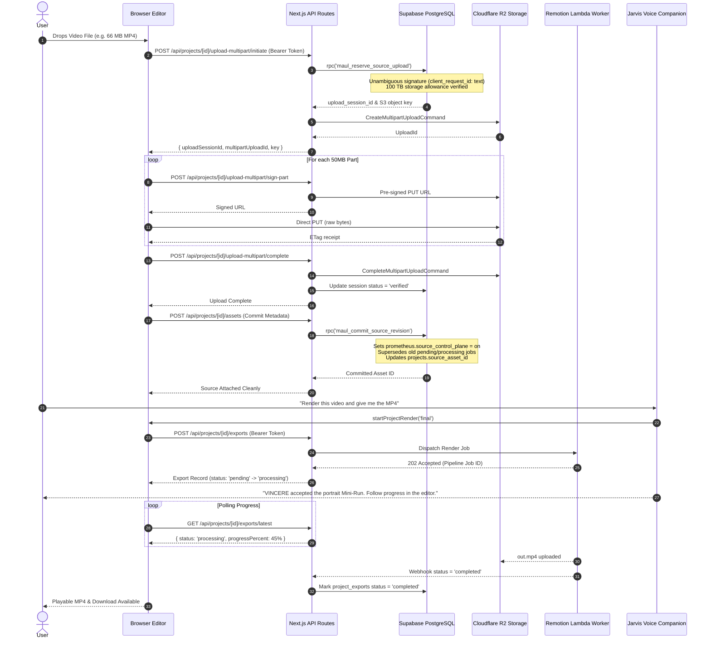

# Prometheus Source Upload & Render Pipeline: Architecture & Emergency Runbook

> **Instant Diagnostic Command:**
> ```bash
> npm run diag:pipeline
> ```
> Runs all 6 database, schema, trigger, storage, and worker health checks in under 5 seconds.

---

## 1. What Happened? (The "Explain Like I'm 13" Story)

Imagine you want to bake a custom pizza using a smart walkie-talkie (Jarvis) to talk to a chef in a kitchen (the render worker) and a warehouse manager (the database).

### Gate 1: The Confused Receptionists (PostgREST PGRST203)
When you brought your ingredients (video file) to the front door, there were **two identical receptionists** named "Maul" standing at the desk.
- One receptionist only accepted paper tickets (`text`).
- The other receptionist only accepted plastic badges (`uuid`).

Whenever you said *"Hey Maul, reserve an oven for my pizza!"*, the front door system froze: *"Wait, WHICH Maul are you talking to?!"* Instead of asking, the system panicked, slammed the door shut, and threw an error. **Result:** Your video was never even allowed through the door.

### Gate 2: The Mismatched ID Cards (Postgres Error 42883)
Even when one receptionist tried to look up your pizza order in the ledger, they tried to compare your student ID card (`uuid`) with a phone number (`text`) without translating them. The database strictly yelled: *"Operator does not exist: uuid = text! I refuse to compare these!"* and cancelled your reservation on the spot.

### Gate 3: The Secret Guard Dog & The Alien Word (Postgres 22P02 & 42501)
Once the ingredients arrived at the kitchen counter, the chef told the warehouse: *"Put this order in the 'queued' bin."*
The warehouse had a strict rulebook with only four allowed words: `pending`, `processing`, `completed`, `failed`. It had never heard the word `queued` in its life, so it threw a dictionary fit!

Then, when the chef tried to write down on the chalkboard where your pizza was stored, a security guard dog barked: *"STOP! You didn't show the secret security pass (`prometheus.source_control_plane = 'on'`)!"* and tore up the note (`SOURCE_POINTER_WORKER_ONLY`).

### Why Jarvis Kept Repeating Those Messages
1. **"The replacement source was not saved. Select the video again before rendering."**
   Because the background upload kept crashing at the front door, the editor put a red sticky note on the project: `isSourceUploadFailed = true`. When you asked Jarvis to render, Jarvis saw the red sticky note and refused to send an empty oven into production.
2. **"No video is attached yet. Add source media to continue."**
   When you refreshed the page to clear the glitch, your browser's temporary local preview disappeared. The editor asked the server: *"Hey, what video is in this project?"* But the request forgot to wear the user's VIP wristband (`Bearer token`), so the server replied *"I don't know who you are (401 Unauthorized)"*. Jarvis looked at the blank editor screen and truthfully reported: *"No video is attached yet."*

---

## 2. Architecture & Data Flow



---

## 3. The 6-Gate Instant Diagnostic Checklist

Whenever any upload, source sync, or Jarvis render issue occurs, run:
```bash
npm run diag:pipeline
```

The script runs these 6 gates:

| Gate | Target | What It Verifies | Instant Fix if Failing |
| :--- | :--- | :--- | :--- |
| **Gate 1** | `maul_reserve_source_upload` | Checks for duplicate OID overloads in `pg_proc` | Run `DROP FUNCTION IF EXISTS public.maul_reserve_source_upload(uuid, uuid, uuid, ...);` |
| **Gate 2** | `client_request_id` Column | Checks `source_upload_sessions.client_request_id` data type | Run `ALTER TABLE public.source_upload_sessions ALTER COLUMN client_request_id TYPE text;` |
| **Gate 3** | `maul_commit_source_revision` | Checks trigger flag `source_control_plane` & enum states | Ensure SQL sets `prometheus.source_control_plane = on` and checks `status in ('pending', 'processing')` |
| **Gate 4** | Cloudflare R2 Credentials | Checks `R2_ACCOUNT_ID`, `R2_BUCKET_SOURCES`, Access Keys | Check `.env.local` or Vercel environment variables |
| **Gate 5** | Storage Quotas | Verifies 100 TB baseline in application and DB | Run `tests/storage-quota-eradication.test.ts` to ensure 100 TB tiers are active |
| **Gate 6** | Live Export Pipeline | Verifies jobs in `pending`, `processing`, or `completed` states | Query `project_exports` to verify Remotion Lambda / worker heartbeat |

---

## 4. Troubleshooting Specific Symptoms

### Symptom A: Jarvis says *"The replacement source was not saved. Select the video again before rendering."*
- **Root Cause**: The editor has `effectiveUploadStatus === 'failed'`.
- **How to verify**: Open browser DevTools Network tab. Check the response of `POST /api/projects/[id]/upload-multipart/initiate` or `POST /api/projects/[id]/assets`.
- **Automatic self-heal**: As of commit `d3a0e0c`, calling `startProjectRender()` queries `/api/projects/[id]/exports`. If the backend confirms `sourceReady: true`, the editor automatically wipes the failed flag and renders immediately.

### Symptom B: Jarvis says *"No video is attached yet. Add source media to continue."*
- **Root Cause**: The editor's `hasPlayableVideo` is `false` because `previewUrl` is null.
- **How to verify**: Check `GET /api/projects/[id]/assets`. If it returns `401 Unauthorized`, the client did not send the user's Bearer token.
- **Fix**: Verify user is logged in via `supabase.auth.getSession()` and that `createClient(req)` is receiving the request in all API routes.

### Symptom C: Jarvis says *"The source video is still uploading to secure cloud storage..."*
- **Behavior**: This is **expected and correct** behavior while a multi-megabyte video file is streaming from the browser to Cloudflare R2.
- **Fix**: Wait for the upload progress indicator in the editor to finish (or the toast "Replacement source saved"). Once complete, asking Jarvis to render will dispatch immediately.

---

## 5. Verification Commands for CI/CD

Before deploying any future change affecting editor, storage, or voice companion:

```bash
# 1. Run pipeline database and storage diagnostic
npm run diag:pipeline

# 2. Run Jarvis render & bridge integration suite
npm run test:jarvis-render

# 3. Run source upload & storage quota suite
npm run test:source-upload

# 4. Strict TypeScript typechecking
npm run typecheck

# 5. Production Next.js build
npm run build
```
